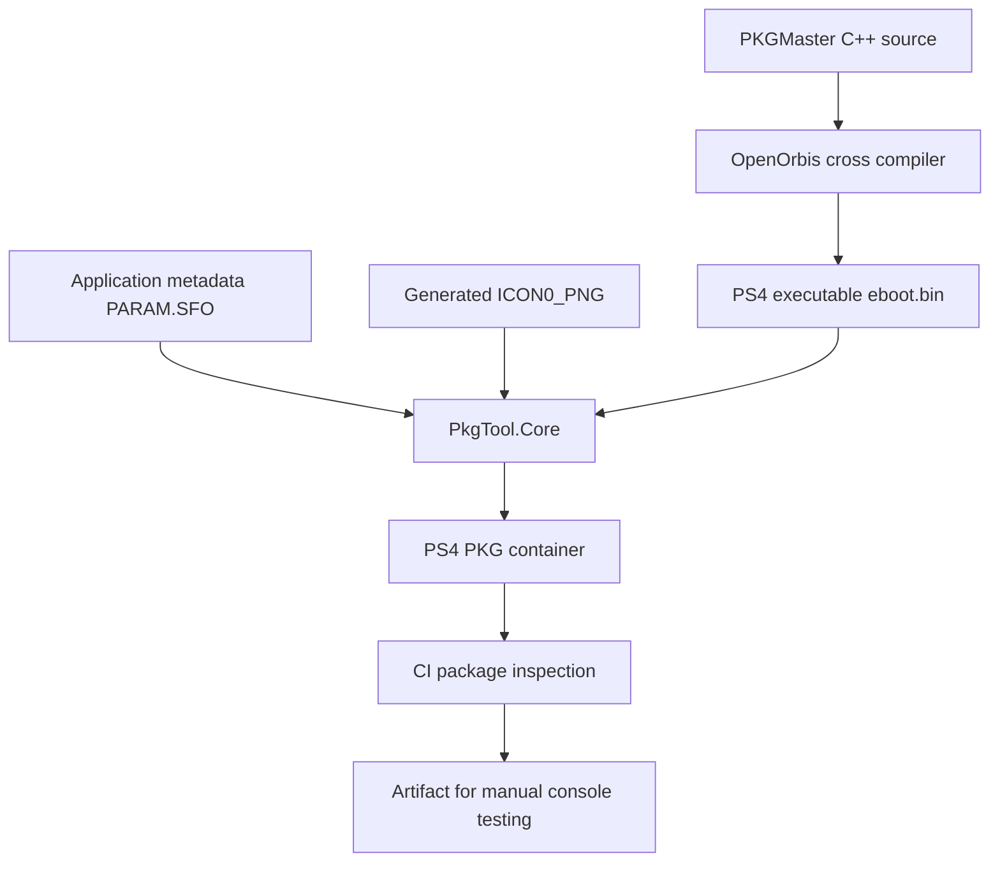

# PKGMaster: what a PS4 PKG is and how this build is made

This guide explains the package container and the current PKGMaster development build. It is written for developers and testers; it is not a guide to bypassing package signatures or console security.

## 1. PKG in plain language

A PlayStation package (`.pkg`) is a structured container understood by the console's package-management system. It is not just a folder and should not be treated as an ordinary ZIP archive. The container includes metadata and payload entries, plus package-level information used by the platform.

For the current homebrew application package, the build specifically checks these pieces:

| Entry / file | Purpose |
|---|---|
| `PARAM.SFO` | Application metadata, including title, title ID and version fields |
| `ICON0_PNG` | Application icon image |
| `uroot/eboot.bin` | Main PS4 application executable payload |
| Package entry table | Describes the content stored in the package |

Exact package acceptance depends on the package format, signing and platform rules. A valid-looking entry table is not equivalent to a console-accepted installable package.

## 2. How PKGMaster's development PKG is produced

The PS4 app is compiled with the OpenOrbis PS4 toolchain. The packaging utility then builds a PKG around the executable, metadata and icon.

### Build stages

1. **Cross-compile:** compile and link the PS4-native code against the OpenOrbis SDK and system libraries.
2. **Prepare metadata and icon:** generate the icon and include the application's SFO metadata.
3. **Package:** use OpenOrbis `PkgTool.Core` to assemble the PKG layout.
4. **Inspect:** enumerate package entries, extract the executable payload, and extract the metadata and icon entries.
5. **Publish artifact:** upload the PKG, raw `eboot.bin` and GP4 project file as a short-lived GitHub Actions artifact.

The CI job also checks expected metadata values (`TITLE=PKGMaster PS4 Boot Test`, `TITLE_ID=PKGM00001`, `APP_VER=0.1.0`) so an accidental metadata change is caught.

## 3. What happens when the user installs a PKG?

At a conceptual level:

1. The package is made available to the console through an installation path supported by the user's system and homebrew environment.
2. The console's package-management service checks whether the package is acceptable under that environment's rules.
3. If accepted, the system processes the package and places its application content in the console's managed storage.
4. The system registers the application so it can be launched from the user interface.

PKGMaster does not replace the console package manager. The current development branch can submit a selected local package to the console's BGFT service after AppInstUtil reads its title ID. BGFT task submission and progress are implemented in code, but final installation still depends on the PS4 environment and must be verified on hardware.

## 4. What PKGMaster currently does with PKG files

The current PS4 Package Library scans the root of `/mnt/usb0` through `/mnt/usb3` and `/data/pkg`. It looks for regular `.pkg` files, up to 64 entries, and displays each filename and size. It is non-recursive. Files are opened and checked with descriptor metadata rather than relying on path-based `stat`.

- D-pad Up/Down: move through the menu/list.
- Cross: open Package Library, inspect a selected package, then open the install confirmation screen.
- Cross again: submit the local package to BGFT.
- Circle: cancel before submission or return after a terminal task state.
- Triangle: rescan storage from the Package Library screen.

The adapter checks the file's regular-file status, size and PS4 PKG magic, asks AppInstUtil to read the package title ID, and compares it with SFO metadata when available. It registers and starts a BGFT local-storage task, then polls BGFT progress. Transfer completion is not a guarantee that the final installation succeeded; check the PS4 system UI. Recursive scanning, complete package classification, and download/phone workflows remain future work.

## 5. What the CI result means

A successful workflow run means the build pipeline completed its cross-compilation, package-generation and package-inspection checks. It is strong evidence that the build process is reproducible in that runner environment.

It does not demonstrate:
- that a physical PS4 accepts the package;
- that the application launches on a specific firmware or GoldHEN release;
- that video and controller input work on every console;
- that USB mount points are available in every setup; or
- that PKGMaster can install another package.

Hardware testing is a separate milestone. Record the exact firmware, GoldHEN version, console model, install result, launch result and any error code when reporting a test.

## 6. Current artifact

The initial boot-test artifact is attached to [workflow run #42503211258](https://github.com/codingscenes2-cyber/Ps4pkg-installer/actions/runs/42503211258). The current native-installer development build is attached to [workflow run #42504984252](https://github.com/codingscenes2-cyber/Ps4pkg-installer/actions/runs/42504984252). The artifact is named `pkgmaster-ps4-boot-test`; it remains a development build, not a stable release. GitHub Actions artifacts expire, so rebuild from the workflow when needed.
